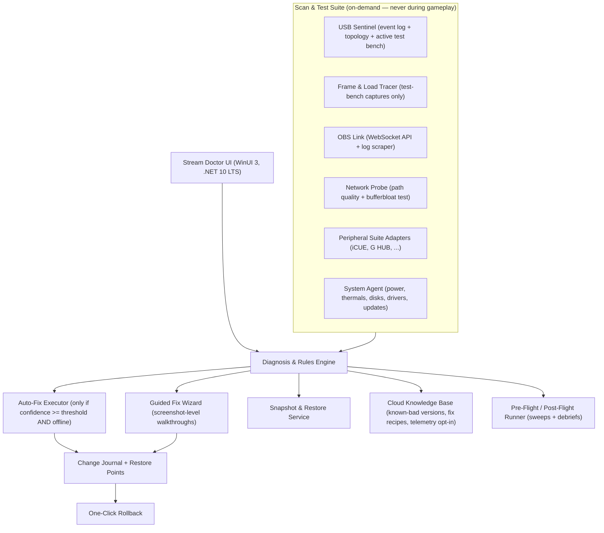

# Stream Doctor 🩺
### A Windows diagnostic & repair app for Twitch streamers

**One-line pitch:** A pre-flight / post-flight "mechanic" for your streaming PC. Run it before you go live for a full health sweep, and after you end for a session debrief. It finds USB dropouts, frame pacing problems, outdated/buggy plugins and peripherals, and a dozen other stream-killers — then fixes them automatically (when safe) or walks you through the fix — with one-click backup and restore of your entire streaming setup. v1 deliberately never runs during gameplay: no anti-cheat exposure, no resource contention.

---

## 1. Vision & Positioning

Streaming setups are fragile *systems*, not apps. A streamer's PC combines a capture pipeline (game → GPU → encoder → Twitch), a USB bus full of cameras, mics, and interfaces, a tangle of vendor software (OBS, iCUE, G HUB, Synapse, Stream Deck, Voicemeeter), and a network path with zero tolerance for jitter. When something breaks mid-stream, the streamer has 30 seconds of chat backseat-driving to figure out which layer failed.

Stream Doctor exists to answer one question: **"Is my rig healthy right now — and if not, what exactly is broken and how do I fix it?"**

| Principle | Meaning |
|---|---|
| **Diagnose before fixing** | Every fix is tied to evidence (logs, traces, counters), never blind shotgun changes. |
| **Runs when you're not** | v1 only runs before and after streams — never during gameplay or while live. No anti-cheat exposure, no real-time performance budget to hit. |
| **Rollback everything** | Every change is journaled and reversible in one click, including a system restore point for driver work. |
| **Explain like a streamer, not a sysadmin** | "Your mic dropped 14 times in the last hour because it's sharing a USB controller with your camera" — not "USBXHCI DeviceReset event 0x500." |

**Target users:** Variety/FPS streamers, just-starting-out streamers (biggest pain, least expertise), and multi-PC setup owners. Secondary: stream deck builders/consultants.

### 1.1 The v1 operating model: pre-flight & post-flight

v1 is a **pull-based, on-demand app** — not an always-on agent. Three windows:

- **Pre-flight (before stream, ~30–60s):** full sweep — USB enumeration + event-log scan, update checks (OBS / plugins / peripherals), network probe, disk space, hotkey collisions, OBS config lint, fresh snapshot. Produces a green/yellow/red board.
- **Post-flight (after stream, ~1–2 min):** correlates the stream's time window against evidence Windows and OBS *already recorded on disk* — OBS logs & session statistics (dropped/lagged/skipped frames), USB disconnect events, app crashes, mid-stream update installs. Produces a debrief: what happened, what it cost, what to fix next time.
- **Test bench (on demand, games closed):** active tests that *generate* load instead of observing it — USB bandwidth benchmarks, controlled re-enumeration, a short local "test broadcast" under synthetic load. See §2.1.

**Why this is the right v1:**
- **No anti-cheat exposure** — nothing runs during gameplay, so there's nothing for Vanguard, FACEIT, or AV heuristics to misread.
- **No resource-contention engineering** — we skip the hardest technical problem in the original design (sub-0.5%-CPU real-time tracing) entirely.
- **Active beats passive diagnostics** — a test bench perturbs the system on purpose and gets answers in minutes; passive monitoring might wait weeks for a fault to recur on its own.
- **The evidence is already on disk** — event logs, OBS logs, and session stats cover most post-hoc diagnosis with zero live collection.

**The honest trade-off:** mid-stream failures are diagnosed after the fact, not intercepted live. Pre-flight sweeps + post-flight debriefs still cover most of the pain; an optional always-on mode with a companion overlay becomes a later paid feature once trust is established (roadmap Phase 4).

---

## 2. The Six Feature Modules

### 2.1 USB Sentinel — USB device misbehavior & dropouts

**What it detects:**
- **Bandwidth saturation** — maps every device to its physical USB controller/hub (via device topology + controller enumeration), flags when high-bandwidth devices (webcams, capture cards) share one controller. Isochronous devices (mics, cams) drop out when a controller saturates even though "there's a free port."
- **Bad connections** — intermittent disconnects, loose cables, flaky hubs, voltage sag (unpowered hubs running power-hungry devices).
- **Driver errors** — device resets in the System event log (Event ID 400/411 `USBXHCI`), "device cannot start" codes, out-of-date or known-bad chipset/USB drivers.
- **Chipset-level issues** — ASMedia vs. Intel/AMD controller differences, xHCI hand-off BIOS settings, PCIe Wi-Fi/capture cards in bandwidth-starved slots.
- **Power management** — USB selective suspend putting interfaces to sleep mid-stream, "allow the computer to turn off this device" checkboxes, aggressive C-states.

**How it fixes:**
- *Auto:* disable selective suspend for flagged devices, disable hub power saving, re-enumerate hung devices, set a high-performance power plan.
- *Guided:* "Move your SM7B interface from the top-left ports to the rear I/O cluster — it's on the same controller as your GoXLR" (with a visual diagram of the physical port map where known, or a guided swap test).
- *Driver:* one-click chipset/USB driver updates with WHQL check, staged install, and rollback.

**The v1 test bench (active, on-demand — games closed):**
- **Port map + bandwidth benchmark:** enumerate the device tree down to controller/port level, then run sustained-load tests against cameras, capture cards, and audio interfaces per controller to measure *actual* available bandwidth — saturation and dying ports show up in minutes, not weeks.
- **Re-enumeration test:** soft power-cycle each device and measure reset latency and error events; a flaky cable or failing port trips this immediately.
- **Guided hot-plug test:** "Unplug your mic and move it to rear port 2." The app watches the topology change and confirms you're now on a different controller.
- **Soak test:** run every device at once for 10 minutes against a *local* test recording — a faithful simulation of stream conditions without going live. Any dropout during the soak reproduces the mid-stream failure safely.

### 2.2 Frame Pacing Doctor — frame drops & stutter

**What it detects:**
- **Game-side frame pacing** — frame-time spikes, stutter, and 1% lows. In v1 this comes from **short test-bench captures** (a 60–90s present-event trace run against a non-anti-cheat workload, or the game played off-stream), not from anything running while live.
- **OBS-side drops** — separates the three OBS failure modes streamers constantly confuse:
  - *Dropped frames* → network problem → hand off to Network module.
  - *Lagged frames* → GPU overload → reduce game load or encoder preset.
  - *Skipped frames* → encoder overload → NVENC/x264 settings, thermals, or CPU contention.
- **Root causes behind them:** thermal throttling, HAGS (hardware-accelerated GPU scheduling) misbehaving with capture, Game Mode conflicts, OBS rendering on the wrong GPU (common on laptop/OEM dual-GPU systems), refresh-rate/multi-monitor issues, shader cache corruption, encoder session limits.

**How it fixes:**
- *Auto:* correct the OBS process GPU affinity on dual-GPU systems, clear shader caches, apply "streamer-safe" Windows settings with a changelog.
- *Guided:* preset/bitrate/resolution suggestions computed from the user's actual CPU/GPU/encode hardware and Twitch's current limits ("your 6600 can run 900p60 HEVC at this bitrate; here's the exact OBS settings block — import it?"), delivered as an **OBS settings profile the app writes via the OBS WebSocket API** rather than a wall of manual steps.
- **Post-flight debrief:** "Last night at 21:47 you had 12 seconds of lagged frames — correlated with plugin X loading its shader cache. Here's the evidence pulled from your OBS log."

### 2.3 Streaming Software Update Manager — OBS, plugins, bots

**What it manages:** OBS Studio, OBS plugins (from the OBS Plugin Marketplace and common standalone plugins), Nightbot, StreamElements desktop app, Streamlabs Desktop, VTube Studio, Chatterino, Voicemeeter, Elgato software.

**What it does:**
- **Version monitoring** with a cloud knowledge base of known-good / known-bad releases ("OBS 31.x with plugin Y crashes on scene switch — hold at 31.0 or update plugin Y to 1.2").
- **Crash log scraping:** parses OBS logs and Windows Event Log for plugin .dll crashes and pins the crash to the specific plugin with a fix link.
- **Safe update flow:** every update is *staged* — full OBS profile/scene backup first (see §2.6), update, sanity-check launch, and one-click revert if anything breaks.
- **Config repair:** fixes common corruption (broken scene collection JSON, orphaned browser sources, duplicate hotkey bindings).
- **Chat/bot token health:** flags expired or revoked OAuth tokens for Nightbot/StreamElements bots *before* the bot goes silent mid-stream.

### 2.4 Peripheral Ecosystem Manager — iCUE, G HUB, Synapse, Stream Deck…

**What it manages:** Corsair iCUE, Logitech G HUB, Razer Synapse, SteelSeries GG, Elgato Stream Deck + Control Center, GoXLR, Wacom, Streamplenty-style macro tools.

**What it detects & fixes:**
- **Update management** with known-bad-version awareness (peripheral vendor updates are notorious for breaking profiles and lighting configs).
- **Resource hogs:** lighting/RGB services eating CPU during games; flags and offers a "game mode" that suspends them.
- **Driver conflicts** between vendor suites (iCUE and G HUB fighting over lighting control is a classic).
- **Device pairing/firmware checks** for Stream Deck and wireless peripherals (dying batteries, polling-rate conflicts).
- **Profile backup** for every suite (see §2.6).

### 2.5 The "You Didn't Ask, But…" Modules

These are the issues that quietly kill streams that nobody diagnoses until they happen:

| Module | Catches |
|---|---|
| **Network Health** | Twitch ingest jitter, packet loss, bufferbloat (wifi vs ethernet, QoS), ISP-side outages, Wi-Fi card power saving, "your dropped frames are your network, not your PC" — with ISP/router-specific guidance |
| **Audio Chain Doctor** | 44.1 vs 48 kHz device mismatches (classic OBS crackle), two devices fighting for default, mic monitoring feedback, noise gate levels, Voicemeeter routing spaghetti, Windows "exclusive mode" conflicts |
| **Thermals & Headroom** | CPU/GPU throttling curves, dust-season warnings, power plan issues, encoder headroom budget ("you're at 95% GPU — one more browser source will lag you") |
| **Capture Card Clinic** | Elgato/AVerMedia handshake failures, HDR passthrough issues, color range/RGB limited vs full mismatch (the "washed out stream" bug), HDMI cable bandwidth |
| **Windows Interference** | Update auto-restarts mid-stream, notification pop-ups (DMs on stream!), Focus Assist off, Game Bar capture conflicts, driver updates scheduled during stream hours — set quiet hours Windows-wide |
| **Anti-cheat & Overlay Conflicts** | Vanguard/FACEIT blocking capture, overlay-injection conflicts with OBS Game Capture ("why is my screen black") |
| **Scene Complexity Audit** | Source/filter counts, browser source memory blowouts, full-res 4K sources downscaled to 1080p canvas, animated overlay packs eating GPU |
| **Privacy & Security** | Stream key/OAuth tokens appearing in pasted logs, accidentally-added window captures with DMs, clip settings, leaked IP risks (DDoS) from exposed addresses in overlays |
| **Disk & Recording Health** | Drive-full before a big stream, NVMe overheating on long recordings, SMART warnings, auto-purge policy for old recordings |
| **Hotkey Collision Map** | OBS vs. game vs. Discord vs. macro-tool hotkey overlaps that silently stop working |
| **Pre-Flight Checklist** | A "Go Live" button that runs a 30-second full-system sweep and gives a green/yellow/red board before every stream |

### 2.6 Snapshot — One-Click Backup, Restore & Migrate

The crown jewel. One button captures the **entire streaming setup**:

**What's in a snapshot:**
- OBS: scenes, sources, profiles, plugin configs, scripts, browser-source URLs and credentials (encrypted at rest with a user passphrase)
- Stream Deck & Elgato profiles; iCUE / G HUB / Synapse / SteelSuite profiles
- Nightbot / StreamElements / chat bot configurations and (encrypted) tokens
- Voicemeeter / GoXLR / audio routing configs
- Relevant Windows settings (power plan, playback devices, hotkeys, privacy/streaming-related settings)
- An inventory manifest: exact driver versions, app versions, device list — so a restore can tell you *what's missing* on the new machine
- Monitor layouts, wallpaper, and stream overlays ("the aesthetic layer")

**How it works:**
- **Full** snapshot to local disk, NAS, or encrypted cloud (restore needs the passphrase — tokens never leave in plaintext).
- **Restore to new PC:** install Stream Doctor on the new machine, log in, pick a snapshot; it installs the right apps, restores configs, and produces a **diff report**: "Everything restored except your Shure driver (Windows version differs) — fix here."
- **Scheduled + pre-event:** auto-snapshot before every update it performs, and before every stream (rolling retention).
- **Selective restore:** restore only your scenes, only your hotkeys, only your audio config.

---

## 3. Architecture

**Key design decisions:**
- **No hooking, no injection, nothing running while you play.** The app reads OS-level traces (event logs, present events, counters) only during test-bench windows, and talks to OBS through its official WebSocket API. v1 has no resident agent at all — anti-cheat isn't even aware of it.
- **Rules engine with confidence scoring.** Each diagnosis is `(symptom evidence) → (root cause hypotheses ranked by confidence) → (fix playbook with prerequisites and rollback plan)`. Fixes execute automatically only above a confidence threshold, only during pre-flight/post-flight windows, and only if the user enabled auto-mode; everything else becomes a guided wizard.
- **Post-flight analysis over live monitoring.** Windows and OBS already record most of what we need (event logs, OBS logs, session statistics). v1 correlates that recorded evidence against the stream's time window instead of watching live — cheaper to build, and diagnosis quality is nearly as good.
- **Change journal.** Every mutation (a registry value, a file replaced, a driver installed, a setting written via OBS API) is recorded with before/after values so rollback is exact and instantaneous.

---

## 4. UX Design

**Four surfaces:**

1. **Dashboard** — a streamer-facing "health score" (0–100) with module gauges, the latest sweep's findings ("Your webcam disconnected and reconnected 3× during last night's stream — likely the hub"), and big green/yellow/red status per subsystem.
2. **The Fix Wizard** — when something's wrong: what happened, the evidence, the fix, and what happens if it doesn't work. Three buttons: *Fix it for me* · *Walk me through it* · *Not now*.
3. **Post-Flight Debrief** — after every stream: what happened, what it cost you, and what to fix before the next one. This is where the "aha" moments live.
4. **Pre-Flight "Go Live" flow** — a one-button sweep with a checklist result board, so nobody finds out their mic is broken from chat.

**Onboarding (first 10 minutes):** detect the setup (what streaming apps, peripherals, capture hardware, network type) → baseline test-bench run (USB sweep + short frame trace + network probe) → create the first snapshot → choose auto vs. guided fix mode.

**Sample moments the UX is designed around:**
- *Pre-flight:* "Yellow: your GoXLR failed its re-enumeration test, and your OBS is two versions behind on a release with a known capture bug. Fix both before you go live?"
- *Post-stream:* "3 fixes applied, 2 need your approval. Your stream had 2% dropped frames at 21:40 — here's why."
- *New PC day:* full restore + diff report in ~20 minutes instead of a weekend of Discord screenshots.

---

## 5. Tech Stack, Language & Dependencies (v1 decision record)

**The v1 pivot changes the calculus.** The original design assumed a resident real-time agent, which justified Rust collectors and low-overhead tracing. v1 is an offline, on-demand app with modest performance needs — so the priority shifts to **developer velocity, Windows API coverage, and long-term maintainability**.

**Decision: single-language C# on .NET 10 (LTS), WinUI 3 (Windows App SDK) UI.**

| Option | Verdict | Why |
|---|---|---|
| **C# / .NET 10 (LTS) + WinUI 3** | ✅ chosen | Microsoft's *strategic* Windows UI path — actively developed, long-term organizational commitment, modern Fluent look, regular security servicing. Exactly the kind of forward-looking API we want: newest tech is fine *because* Microsoft backs it for the long haul |
| C# / .NET 10 + WPF | fallback, not chosen | Also fully supported (as long as .NET exists) and battle-tested, but feature-frozen. Keep it as the escape hatch: both are XAML + MVVM, so a mid-project switch costs weeks, not months |
| Rust (UI + services) | ❌ for v1 | Superb candidate for the Phase 4 resident agent; for an offline utility it triples dev time on Windows interop with no perf payoff |
| Electron / Tauri | ❌ | Electron = bloat + large attack surface; Tauri splits the codebase into two languages; zero benefit for a system utility |
| Go | ❌ | Weak Windows desktop story (UI, COM, interop) |

**Why this holds up for an independent project built with AI assistance:**
- **The AI feedback loop matters more than the AI's raw fluency.** C# is statically typed with a strict compiler: AI-generated code gets verified instantly at build time, and hallucinated APIs fail loudly instead of silently. More "AI-fluent" languages (Python, JS) catch far less of what the model gets wrong.
- **Training corpus fit — the domain knowledge is anchored to our language.** C# is among the best-represented languages in AI training data, and — critically for this project — the Windows API domain (WMI, ETW, interop, WinUI 3) is documented almost exclusively through C# samples by Microsoft. Choosing Python or Rust would divorce our language from the ecosystem's documentation and the model's strongest knowledge of our exact problem domain.
- **One language multiplies AI leverage for a solo dev.** A single language across UI, services, tests, and interop means one set of conventions in the AI's context window, no translation friction, and every helper/test the AI writes composes with everything else.
- **Honest caveat:** AI help will be weakest exactly where it's weakest for humans too — USB IOCTL details, ETW session quirks, Media Foundation COM plumbing. That's mitigated structurally: `CsWin32` replaces hand-written (and AI-hallucinated) interop with machine-generated declarations, the open-source USBView sample is the canonical reference to feed the AI when working on topology code, and golden-file tests over real (anonymized) OBS logs make log-parsing logic objectively verifiable.

**Rust head-to-head — why C# genuinely wins here, not just by default.** Rust's real advantages (runtime performance, memory footprint, tiny binaries, strong supply-chain tooling) are advantages this app can't use: v1 is an offline, on-demand scan tool — I/O-bound and UI-heavy, not compute-bound. Meanwhile the app's *hard parts* are exactly where Rust is weakest for a solo dev: the entire diagnostic surface is COM/Win32 territory (WMI, Media Foundation, WASAPI, SetupAPI, ETW), where Rust means hand-managed COM lifetimes in `unsafe` code with thinner AI training data; ETW session tooling exists only as small community crates — which violates our own dependency policy — versus Microsoft's mature `TraceEvent`; and there is no credible native-Windows UI story in Rust (egui/iced/Tauri are community or web-based). Rust becomes the right answer again at Phase 4, where the resident agent's hard real-time overhead budget justifies it.

**Dependency policy — adopt forward-looking, never orphaned.** The filter is not age or churn; it's *organizational backing + a visible security-maintenance track record*:
1. **BCL first.** Anything in the .NET base library (JSON, HTTP, compression, crypto, WebSockets, event-log reading) is used before any package is added.
2. **Microsoft-maintained next** — packages backed by the .NET/Windows orgs with multi-year histories.
3. **Then, only**: very large community projects with multi-year continuous release history and a visible security process. Brand-new two-maintainer repos are rejected no matter how popular — the risk isn't the code, it's not knowing if anyone will ship a security fix in a year.
4. **Never:** kernel drivers, obscure micro-libraries, anything without a security policy.
5. Every dependency is pinned (lockfile), scanned in CI (`dotnet list package --vulnerable --include-transitive`), and recorded in a generated SBOM.

**Approved dependency list (short — that's the point):**

| Dependency | Purpose | Status |
|---|---|---|
| `Microsoft.Windows.CsWin32` | Source-generated P/Invoke & COM interop (SetupAPI, CfgMgr32, Media Foundation, WASAPI) — eliminates hand-rolled interop bugs | Microsoft, MIT, active |
| `Microsoft.Diagnostics.Tracing.TraceEvent` | ETW session control + present-event parsing for test-bench captures | Microsoft, MIT, mature (powers PerfView) |
| `System.Management` | WMI queries (power plans, GPU info, driver versions) | .NET team, Windows-only |
| `Microsoft.Data.Sqlite` | Change journal, scan results, snapshot index (SQLite core is public domain, decades stable) | Microsoft, active |
| `CommunityToolkit.Mvvm` | MVVM scaffolding for WinUI 3 | Microsoft, MIT, active |
| Serilog (file sink) | Structured logging | Large community, active, stable API |
| **winget (Windows Package Manager CLI)** | The update *engine* for OBS, iCUE, G HUB, Stream Deck, etc. — ships inside Windows 10/11, so zero shipping cost, and it performs installer trust/signature verification for us | Microsoft, built into the OS |

**Explicitly rejected:**

| Rejected | Reason |
|---|---|
| LibreHardwareMonitor / OpenHardwareMonitor | Depend on the WinRing0 kernel driver — known CVEs, on Microsoft's vulnerable-driver blocklist. Violates "no kernel drivers, ever" and trips AV heuristics. Thermal data in v1 comes from vendor user-mode APIs (NVML / ADLX) or is skipped. |
| BouncyCastle or any crypto lib | BCL crypto (`System.Security.Cryptography`: AES-GCM, PBKDF2) covers snapshot encryption completely |
| Chocolatey | winget already ships with the OS; a second package manager is pure attack surface |
| CefSharp / embedded browsers | Not needed; system dialogs and external links suffice |
| ReactiveUI, Prism, heavy DI containers | Bloat for a utility app; `CommunityToolkit.Mvvm` + manual DI is enough |

**Security posture (v1):**
- **No kernel drivers, no resident background processes.** UAC elevation is requested only for the specific fix action that needs it — never at launch.
- **Update integrity:** all third-party installs execute through winget (signature-verified). Where a vendor download is unavoidable, verify Authenticode signature + SHA-256 against the knowledge base before executing.
- **Snapshot encryption:** AES-256-GCM, key derived via PBKDF2 from a user passphrase; tokens are never written in plaintext anywhere.
- **Supply chain:** pinned lockfile, CI vulnerability scanning of transitive packages, generated SBOM, releases signed with an EV code-signing certificate (SmartScreen reputation).
- **Network:** the cloud knowledge base is TLS-only, opt-in, and carries no PII — the app is fully functional offline.

---

## 6. Monetization (freemium)

- **Free:** diagnostics, health score, guided fixes, local snapshots.
- **Pro (~$8/mo):** auto-fix mode, cloud snapshots, known-bad-version alerts before they bite, migrate-to-new-PC flow — plus the future always-on mode & companion overlay if/when they ship.
- **Team:** for stream teams/orgs — fleet health across multiple creator PCs.

---

## 7. MVP Roadmap

1. **Phase 1 — the offline Pre-Flight/Post-Flight app (v1):** USB Sentinel (event-log scan + active test bench), OBS Link (log scraping + WebSocket config lint & fix), post-flight frame-drop analysis from OBS logs/stats, software & peripheral update checks, guided fixes + change journal, local snapshot/restore, Pre-Flight checklist. Covers the majority of real streamer pain with zero anti-cheat or resource-contention risk.
2. **Phase 2:** Auto-fix executor with confidence thresholds, Network Health module, privacy/security checks (token leaks, DM window captures), config repair, scheduled sweeps.
3. **Phase 3:** Peripheral suite adapters (iCUE first), cloud snapshots, new-PC migration flow.
4. **Phase 4 (optional always-on):** A low-overhead resident agent + on-stream companion overlay — the point where anti-cheat vendor engagement becomes a hard requirement. Community playbook marketplace, fleet/team mode.

---

## 8. Risks & Open Questions

- **Vendor breakage velocity:** peripheral vendors ship breaking updates constantly; the knowledge base needs a fast community-report pipeline to stay ahead.
- **Fix correctness:** a wrong auto-fix damages trust permanently — hence conservative thresholds, changelogs, and instant rollback as non-negotiable v1 features.
- **Windows update churn:** detection logic must track Windows release changes (ETW providers occasionally change); keep collectors behind an abstraction with per-build tests.
- **Anti-cheat perception (deferred):** v1 never runs during gameplay, so this risk is deferred to the optional always-on phase; engage anti-cheat vendors *before* building that, not after.
- **Scope discipline:** the "everything" trap — each module must ship with a measurable "streams saved" metric before the next one starts.

---

## 9. v1 USB Test-Bench Protocols

**Shared infrastructure (all tests build on this):**

*Device topology mapping — the "map" every test reads from:*
- Enumerate host controllers via `GUID_DEVINTERFACE_USB_HOST_CONTROLLER`; walk hubs with `IOCTL_USB_GET_NODE_CONNECTION_INFORMATION_EX` and `IOCTL_USB_GET_NODE_CONNECTION_NAME` (the open-source OSR **USBView** sample is the canonical reference implementation).
- Assign every device a `(controller → hub → port)` address using CfgMgr32 (`CM_Get_Parent`, `CM_Get_DevNode_Registry_Property` for location paths).
- Cache the map and diff before each test — a device that silently moved controllers between scans is itself a finding.

*Evidence collector:* every test runs against a live tail of the System event log (Kernel-PnP and xHCI provider events) plus the test's own measurements, all stamped against a monotonic clock so results correlate cleanly in post-flight analysis.

**Test 1 — Controller saturation / bandwidth benchmark**
Goal: prove which controller a device set saturates.
1. List devices per controller, by class.
2. Put devices under **real capture load, not synthetic**: webcams/capture cards via Media Foundation (`IMFSourceReader` at native max resolution/FPS), audio interfaces via WASAPI capture at max channels/rate, storage via sustained reads.
3. Ramp: one device active → all devices on that controller active simultaneously.
4. Measure per-device failure counters while loaded: MF dropped-frame counts, WASAPI glitch/discontinuity counts, any new xHCI error events.
5. Verdict per controller — any device erroring under "all at once" load = fail, with a specific recommendation ("camera + capture card saturate controller 2 — move the capture card to controller 3, which is idle").

**Test 2 — Re-enumeration (device reset) test**
Goal: expose flaky cables, marginal ports, hung devices.
1. Per device: soft-disable then re-enable via `SetupDiChangeState` (DICS_DISABLE → DICS_ENABLE).
2. Measure time to disappear, time to reappear, and error events during the cycle.
3. Flag slow reappearance (>2s), failure to return, or errors mid-cycle.
4. Repeat 5× per device — intermittent faults show as 1-of-5 failures.

**Test 3 — Guided hot-plug test**
Goal: make the user's mental model match physical reality.
1. "Unplug your mic now." The app watches the topology diff to identify which port the device left.
2. "Now plug it into the bottom rear port." Confirms arrival on the expected controller.
3. Output: an **annotated physical port diagram** saved with the machine profile, so all future advice says "rear port 3," never "controller 01.00.4."

**Test 4 — Soak test (the mid-stream simulation)**
Goal: reproduce stream-night conditions safely.
1. Everything at once: all cameras capturing, all interfaces recording, OBS running a **local (not live) recording** of the real stream scene collection.
2. Duration: 10 minutes default.
3. Watch every device's error counters, OBS recording stats (render lag, skipped frames), and new event-log entries.
4. Any dropout during the soak = a **reproduced mid-stream failure with full evidence captured** — the highest-value diagnostic event the app can produce.

**Test 5 — Power-management audit (static, no perturbation)**
Goal: find settings that put devices to sleep mid-stream.
- Per device, read selective-suspend / idle-power properties (`AllowIdleIrpInD3`, `SelectiveSuspendEnabled`, `EnhancedPowerManagementEnabled`), hub power settings, active power plan, USB suspend settings, and PCIe link-state power management.
- Flag risky combinations ("your audio interface allows idle power-down — the classic 'mic goes silent after a quiet stretch' cause"). Fix is a guided wizard; every registry write goes through the change journal.

## 10. Post-Flight Log-Correlation Engine

All of post-flight runs against evidence recorded **during** the stream — the app itself wasn't running. Four steps:

**Step 1 — Define the session window.** From the OBS log: locate the stream session ("Starting streaming" → "Stopping streaming", or obs-websocket StreamStarted/Stopped events). This window bounds every correlation.

**Step 2 — Build the event timeline.** Merge, sort, and normalize to UTC:
- **OBS session statistics** (OBS writes stats every ~2s: dropped/lagged/skipped frame counts, bitrate, congestion)
- **OBS log events**: scene switches, source activation, plugin loads/errors, encoder-overload messages, render-lag notices
- **Windows System event log** within the window: USB/xHCI events, device arrivals/removals, app crashes (WER), service failures, Windows Update and driver installs, power events, GPU driver resets (TDR)
- Scheduled-task completions, to catch "an update restarted a service mid-stream"

**Step 3 — Run correlation rules.** Each rule is `(trigger pattern → hypothesis → evidence bundle → fix playbook)`, scored transparently:
`confidence = base_weight × supporting_evidence_lines − contradicting_evidence`
Representative rules:
- OBS "audio source disconnected" at 21:03 + xHCI reset event at 21:02:58 → **USB dropout** → link to Test 2/4 results and §2.1 fixes.
- Dropped frames rising all session, no local errors, congestion % climbing → **network-side** → hand off to Network module.
- Lagged frames spike within 60s of switching to the "Starting Soon 4K" scene → **scene complexity** → run the Scene Audit; offer downscale.
- Encoder overload + skipped frames + a browser-source plugin loaded that day → **plugin culprit** → check known-bad list.
- TDR/GPU reset event at 21:47 + 12s of frozen stream → **driver/GPU issue** → driver version check + HAGS toggle suggestion.

**Step 4 — Produce the debrief.** Ranked findings, each with: what the user experienced (plain language), the evidence (a clickable timeline snippet), the root cause, the fix, and what to watch next stream. **Findings feed the next pre-flight** — anything diagnosed post-flight automatically becomes a pre-flight check item.

**Data model sketch:**
- `ScanEvent { timestamp, source (OBS | EventLog | Test), category, severity, payload }`
- `Finding { hypothesisId, confidence, evidence: [ScanEvent], fixPlaybookId }`
- Stored in SQLite with rolling retention — this quietly accumulates the most valuable dataset in the app: per-user failure history.

## 11. v1 Project Structure & Milestones

**Solution layout (single repo, five projects):**
- `StreamDoctor.Core` — domain model: scans, findings, fixes, journal, snapshots. No I/O; fully unit-testable.
- `StreamDoctor.Windows` — the collectors: topology, event log, ETW, OBS link, test bench. All CsWin32 interop lives here and nowhere else.
- `StreamDoctor.Fixes` — fix playbooks + change-journal executor.
- `StreamDoctor.App` — WinUI 3 UI (Dashboard / Pre-Flight / Post-Flight / Fix Wizard).
- `StreamDoctor.Tests` — xUnit; rules engine and log parsers get golden-file fixtures built from real (anonymized) OBS logs.

**Milestones (each ends demo-able):**
- **M1 — "Know the machine":** topology map, device inventory, static USB power audit, event-log scan, health-board UI. Read-only diagnosis; nothing fixes anything yet.
- **M2 — "Know OBS":** log scraper, session windowing, obs-websocket connect, config lint, first post-flight debrief with ~5 correlation rules.
- **M3 — "Prove it":** test bench (re-enum, bandwidth benchmark, soak), 10+ correlation rules, evidence-linked findings UI.
- **M4 — "Make it reversible":** change journal, guided fixes (USB power settings, OBS settings via websocket), one-click rollback.
- **M5 — "Ship value":** snapshot/restore, update manager via winget, pre-flight checklist, signed installer.